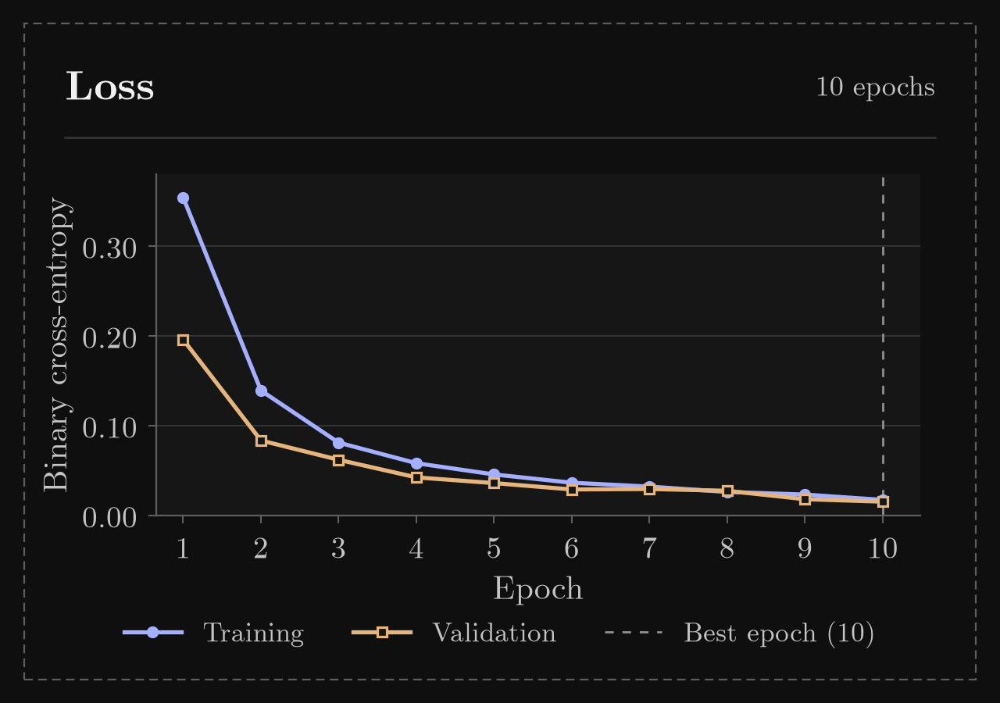
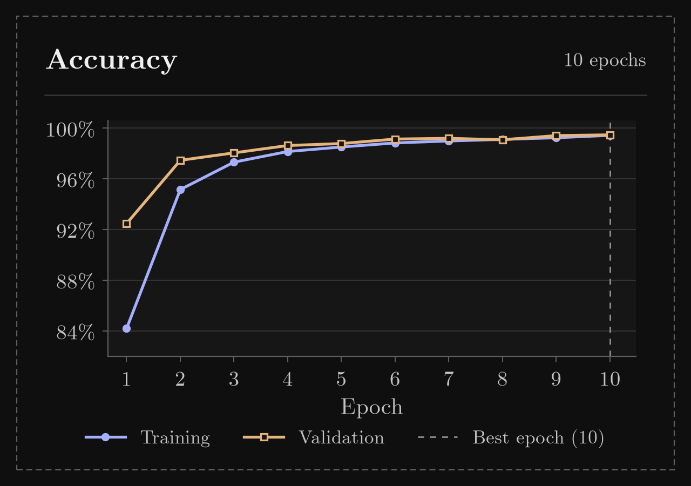
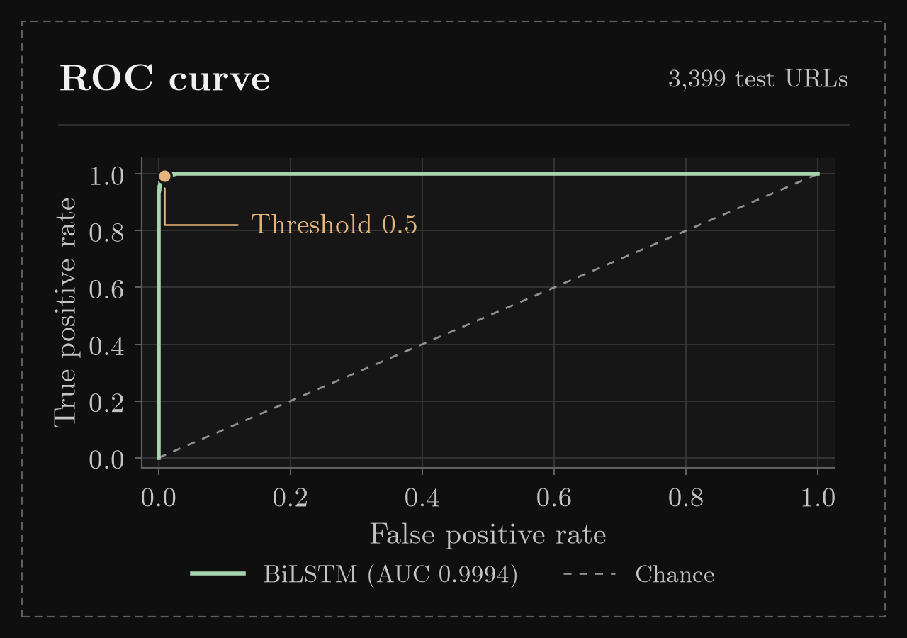
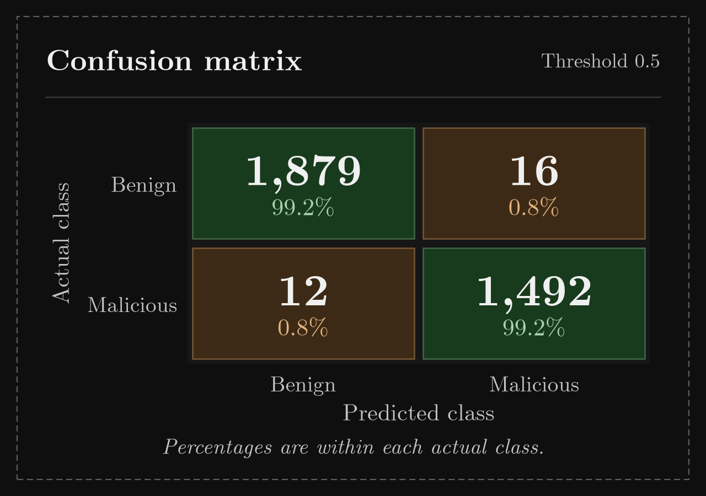

# NLP Phishing Detection


*Originally built in January 2024, and updated more recently to improve the documentation.*

A deep learning system that detects phishing URLs. A character-level **bidirectional LSTM** network,
trained on verified phishing reports from [PhishTank](https://phishtank.org/), scores each URL, and a
**Flask REST API** serves the predictions.

Phishing links often imitate legitimate ones with small character-level tricks: misspelled brand names,
unusual top-level domains, deeply nested subdomains, or long encoded paths. Instead of hand-crafted
features or blocklists, this model reads the raw URL one character at a time and learns these patterns
directly from data.

<p align="center">
  
</p>

## Highlights

- **End-to-end ML pipeline:** data loading, character-level tokenization, training with early stopping
  and checkpointing, held-out evaluation, and model serving.
- **Sequence model built for raw text:** three stacked bidirectional LSTM layers over learned character
  embeddings, with about 3.0M parameters.
- **Reproducible evaluation:** a seeded train/validation/test split, with the test set rebuilt exactly
  at evaluation time to report accuracy, precision, recall, F1, ROC AUC and a confusion matrix.
- **Production-style serving:** a REST API with input validation, a health check and structured JSON
  responses, plus a command-line client.
- **Tested and linted:** a pytest suite covering the tokenizer, data split, metrics and API, with
  [Ruff](https://docs.astral.sh/ruff/) for linting and formatting.

## Results

The released model was trained on an NVIDIA T4 GPU.

The held-out test set contained 3,399 URLs. The classifier used a decision threshold of 0.5.

| Test-set metric |  Value |
| --------------- | -----: |
| Accuracy        | 0.9918 |
| Precision       | 0.9894 |
| Recall          | 0.9920 |
| F1              | 0.9907 |
| ROC AUC         | 0.9994 |
| Specificity     | 0.9916 |

Validation loss was lowest at epoch 10 of 10.

| Split      |   Loss | Accuracy |
| ---------- | -----: | -------: |
| Training   | 0.0172 |   0.9943 |
| Validation | 0.0152 |   0.9947 |

<p align="center">
  
  
</p>
<p align="center">
  
  
</p>

The benign examples come from a small number of hosts, so these scores overstate how well the model
handles unseen sites. See [Limitations and Future Work](#limitations-and-future-work).

## Model Architecture

Each URL is lowercased, mapped character by character to integer ids, and left-padded or truncated to
128 characters. A learned embedding turns each character into a 128-dimensional vector. Three stacked
bidirectional LSTMs read the sequence in both directions, so each layer sees what comes before and
after every character. A sigmoid unit then outputs the probability that the URL is malicious.

| Layer                                | Output shape | Parameters |
| ------------------------------------ | ------------ | ---------: |
| Embedding (70-character vocabulary)  | (128, 128)   |      8,960 |
| Bidirectional LSTM, 256 units        | (128, 512)   |    788,480 |
| Bidirectional LSTM, 256 units        | (128, 512)   |  1,574,912 |
| Bidirectional LSTM, 128 units        | (256)        |    656,384 |
| Dense, sigmoid                       | (1)          |        257 |
| **Total**                            |              |  **3,028,993** |

Each LSTM layer uses 30% dropout on its inputs and on its recurrent state. Training uses the Adam
optimizer with binary cross-entropy loss, and early stopping on validation loss with a patience of
2 epochs.

## Dataset

| Source                                                              | Label     |   URLs |
| ------------------------------------------------------------------- | --------- | -----: |
| [`phishtank_malicious_urls.csv`](data/phishtank_malicious_urls.csv) | Malicious | 29,769 |
| [`benign_urls.txt`](data/benign_urls.txt)                           | Benign    | 38,228 |

The malicious URLs are verified submissions from a PhishTank export (October 2018). The benign URLs
come from a whitelist of legitimate pages. Duplicates are removed, and a URL that appears in both
sources is labelled benign. The data is split with a fixed seed into **80% training, 15% validation and
5% test**.

## Getting Started

Requires Python 3.10 or later.

```bash
git clone https://github.com/rawsab/nlp-phishing-detection.git
cd nlp-phishing-detection

python -m venv .venv
source .venv/bin/activate        # Windows: .venv\Scripts\activate
pip install -r requirements.txt
```

## Usage

### Serve predictions

```bash
python -m phishing_detector.api              # http://localhost:45000
```

In a second terminal, classify a URL with the included client:

```bash
python -m phishing_detector.client "http://paypal-account-verify.secure-login.xyz/webscr/cmd=login"
```

```json
{
  "url": "http://paypal-account-verify.secure-login.xyz/webscr/cmd=login",
  "malicious_probability": 0.9999,
  "is_malicious": true,
  "verdict": "The URL is likely to be malicious.",
  "warning": null
}
```

or call the API directly:

```bash
curl -X POST http://localhost:45000/predict \
     -H "Content-Type: application/json" \
     -d '{"url": "https://www.google.com"}'
```

### Train and evaluate

```bash
python -m phishing_detector.train        # writes models/
python -m phishing_detector.evaluate     # writes reports/
```

Training saves the best checkpoint, the fitted tokenizer and the per-epoch history to `models/`.
Evaluation rebuilds the exact test split from that history and writes `metrics.json` plus training
curve, ROC curve and confusion matrix plots to `reports/`. Training is much faster on a GPU. If the GPU
runs out of memory, lower `--batch-size` (default 256).

### Run the tests

```bash
pip install -r requirements-dev.txt
pytest
ruff check .
```

## API Reference

| Method | Endpoint   | Description                                    |
| ------ | ---------- | ---------------------------------------------- |
| `GET`  | `/health`  | Returns `{"status": "ok"}` when the API is up  |
| `POST` | `/predict` | Classifies the URL in the body `{"url": "..."}` |

| Response field          | Type           | Description                                                   |
| ----------------------- | -------------- | ------------------------------------------------------------- |
| `url`                   | string         | The URL that was classified                                   |
| `malicious_probability` | float          | Model output in `[0, 1]`                                      |
| `is_malicious`          | bool           | `true` if the probability is at least 0.5                     |
| `verdict`               | string         | Human-readable result                                         |
| `warning`               | string \| null | Set for base URLs (no path or query), where accuracy is lower |

A missing, empty or non-string `url`, or one longer than 2,048 characters, returns `400` with an `error`
message.

## Project Structure

```
├── data/                          Training data (PhishTank export + benign whitelist)
├── docs/                          Architecture diagrams and the script that generates them
├── models/                        Trained model, tokenizer vocabulary, training history
├── reports/                       Evaluation metrics and figures
├── phishing_detector/
│   ├── api.py                     Flask REST API
│   ├── client.py                  Command-line client for the API
│   ├── config.py                  Paths, hyperparameters and split settings
│   ├── data.py                    Dataset loading and train/validation/test split
│   ├── detector.py                Inference wrapper (tokenizer + model)
│   ├── evaluate.py                Test-set metrics and plots
│   ├── model.py                   BiLSTM architecture
│   ├── tokenizer.py               Character-level tokenizer
│   └── train.py                   Training script
├── tests/                         pytest suite
├── requirements.txt
└── requirements-dev.txt
```

## Limitations and Future Work

- **Narrow benign data.** Over 80% of the 38k benign URLs come from just 10 hosts (for example
  `support.office.com`, `store.apple.com` and `plus.google.com`). Test-set scores therefore overstate
  how well the model handles legitimate sites it has rarely seen. The model flags both the PhishTank
  FAQ (`https://phishtank.org/faq.php`) and Wikipedia's phishing article
  (`https://en.wikipedia.org/wiki/Phishing`) as malicious.
- **Few base URLs.** Fewer than 4% of benign examples are bare domains, so the API attaches a warning
  to predictions for them.
- **Dated phishing data.** The phishing URLs are from 2018, and phishing tactics have changed since.

Next steps would be a broader benign corpus (for example the [Tranco](https://tranco-list.eu/) top-sites
list plus crawled pages), recent phishing feeds, a domain-disjoint test split to measure generalization
to unseen sites, and calibrating the decision threshold on held-out data.
